# Viducate - Global Online Education Platform

Viducate is a professional, high-performance online education platform designed for video-based learning. It empowers teachers to share knowledge through structured courses and quizzes, while providing students with a seamless, progress-tracked learning experience.


## ▶️ Live demo

**[utku-kucuk.github.io/viducate](https://utku-kucuk.github.io/viducate/)**

| Role | Email | Password |
| --- | --- | --- |
| Admin | `admin@viducate.demo` | `demo1234` |
| Teacher | `teacher@viducate.demo` | `demo1234` |
| Student | `student@viducate.demo` | `demo1234` |

The demo is a static build of the frontend: a mock API in `frontend/src/demo/` answers every request in the browser with fictional sample data, using the same response shapes as the Express backend. Each visitor gets their own copy in `localStorage`, uploads are simulated, the demo accounts are protected from deletion and changes, and **Reset demo** restores the seed. To run the real stack with the backend, follow the [Detailed Setup Guide](#️-detailed-setup-guide) below.

## 🌟 Key Features

### 🎓 For Students
- **Interactive Course Player**: High-quality video streaming with progress persistence.
- **Progress Tracking**: Intelligent tracking based on viewing percentages and time duration.
- **Assessments**: Built-in quiz system to validate learning outcomes.
- **Personal Notes**: Take time-stamped notes directly while watching videos.
- **Resource Center**: View and download supplementary course materials (PDFs, PPTs).
- **Multi-language Support**: Fully localized interface in English and Turkish.

### 👨‍🏫 For Teachers
- **Course Studio**: Comprehensive tools to create and manage structured course content.
- **Advanced Video Upload**: Support for high-volume video uploads with processing status.
- **Quiz Builder**: Dynamic creation of assessments with multiple question types.
- **Analytics Dashboard**: Real-time insights into student engagement and progress.
- **Category Management**: Organize content into intuitive departments and categories.

### 🛡️ For Administrators
- **User Governance**: Full CRUD operations for user management and role assignment.
- **Corporate Integration**: Native LDAP/Active Directory support for enterprise environments.
- **System Configuration**: Fine-tune platform settings, security policies, and site-wide features.
- **Security**: JWT-based authentication, role-based access control (RBAC), and rate limiting.

---

## � Screenshots Gallery

### 🌐 Landing & Discovery
| | |
|---|---|
| 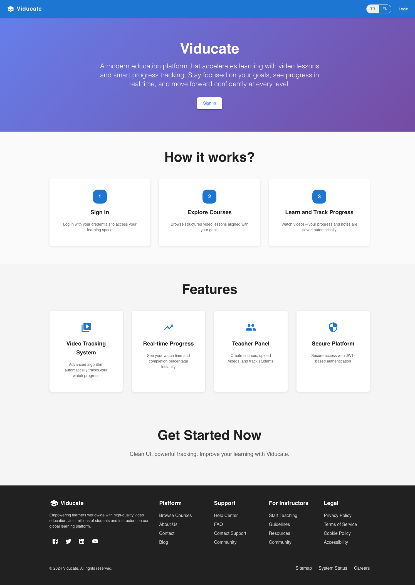 | 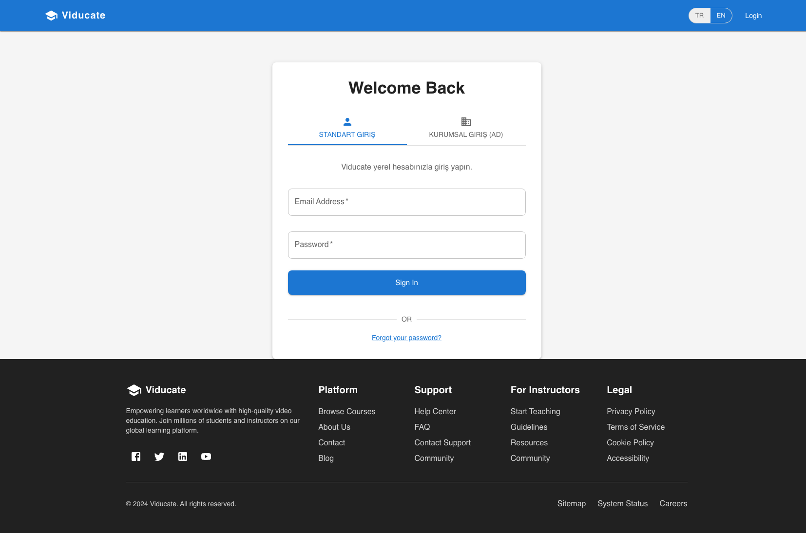 |

### 🎓 Student Experience
| | |
|---|---|
| 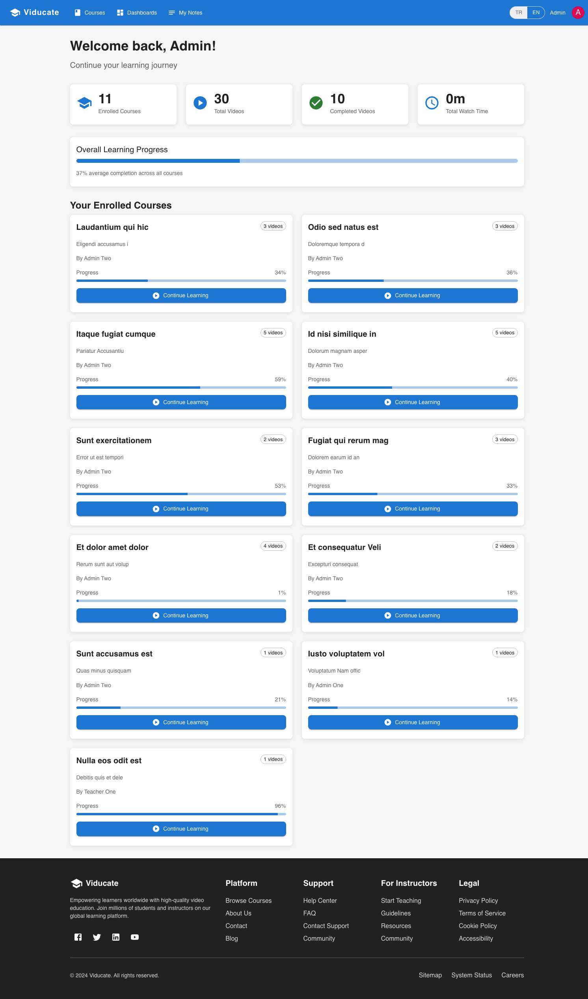 | 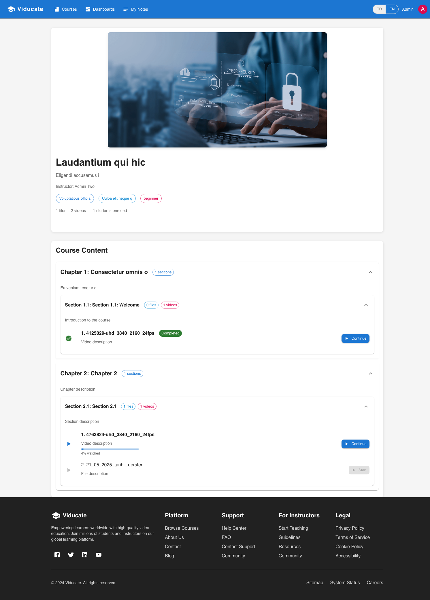 |
| 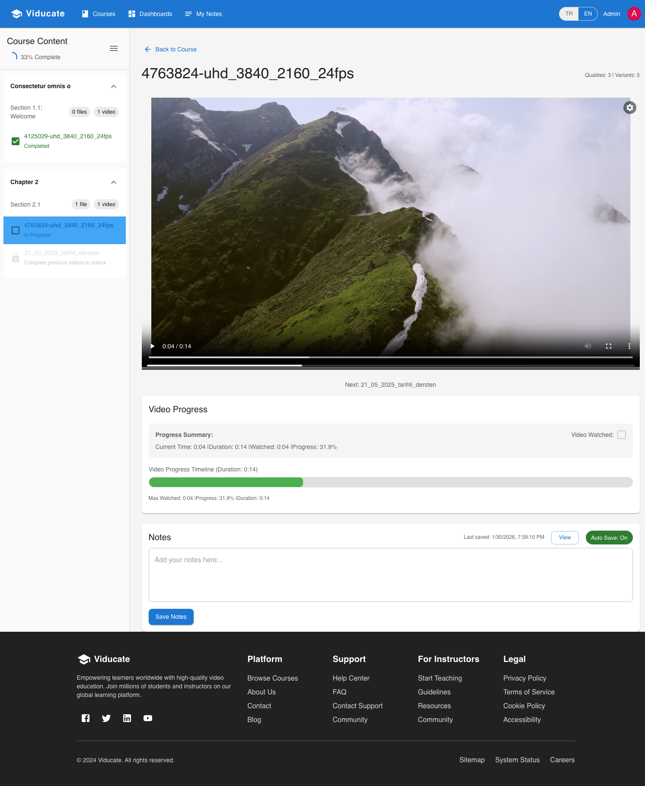 | 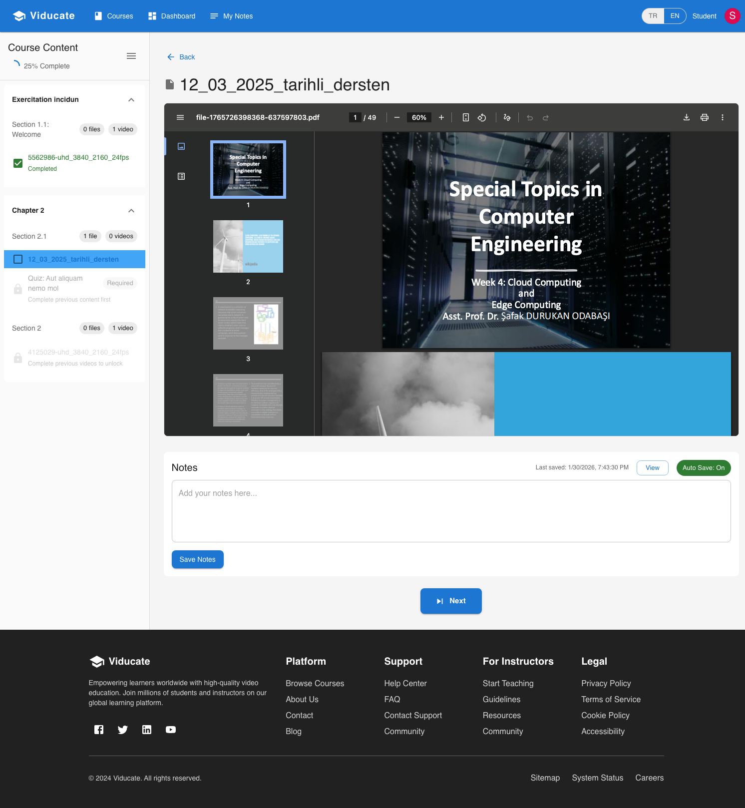 |

### 👨‍🏫 Teacher Studio
| | |
|---|---|
| 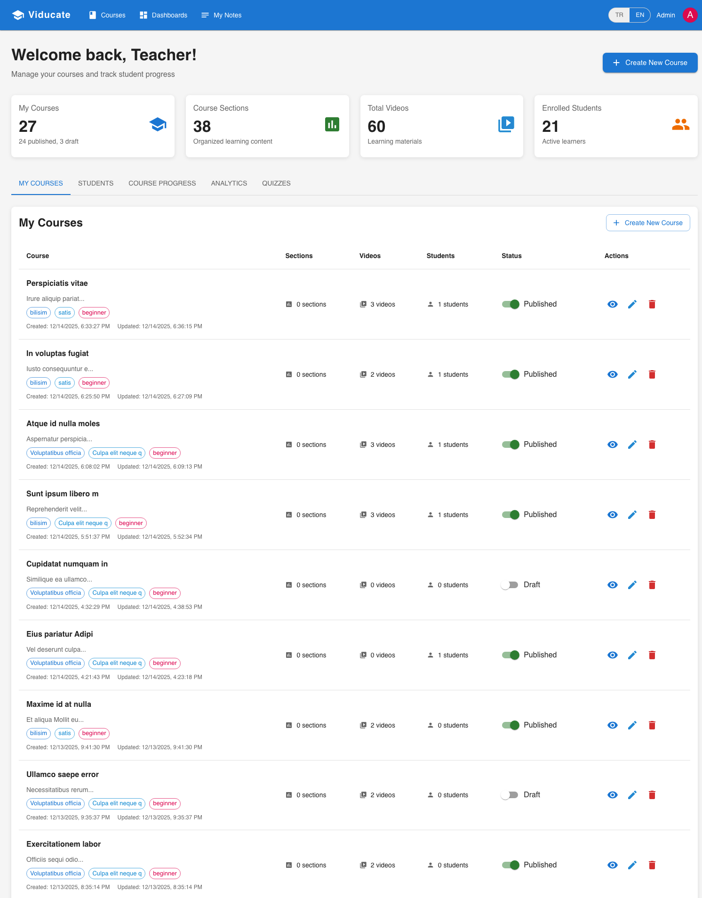 | 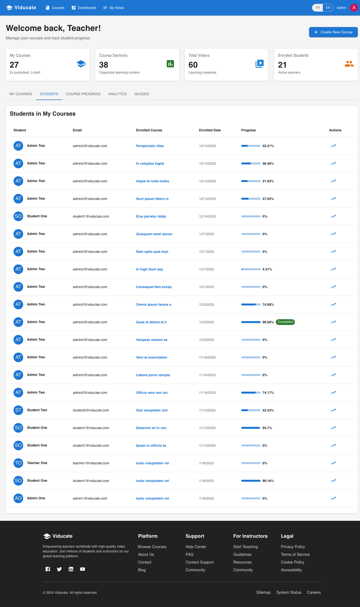 |
| 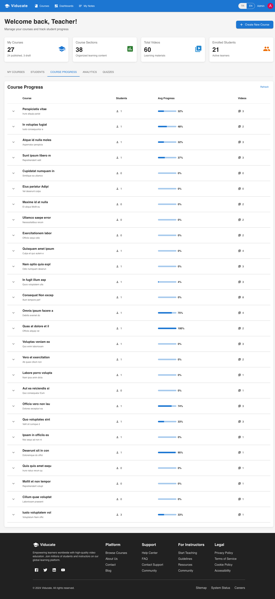 | 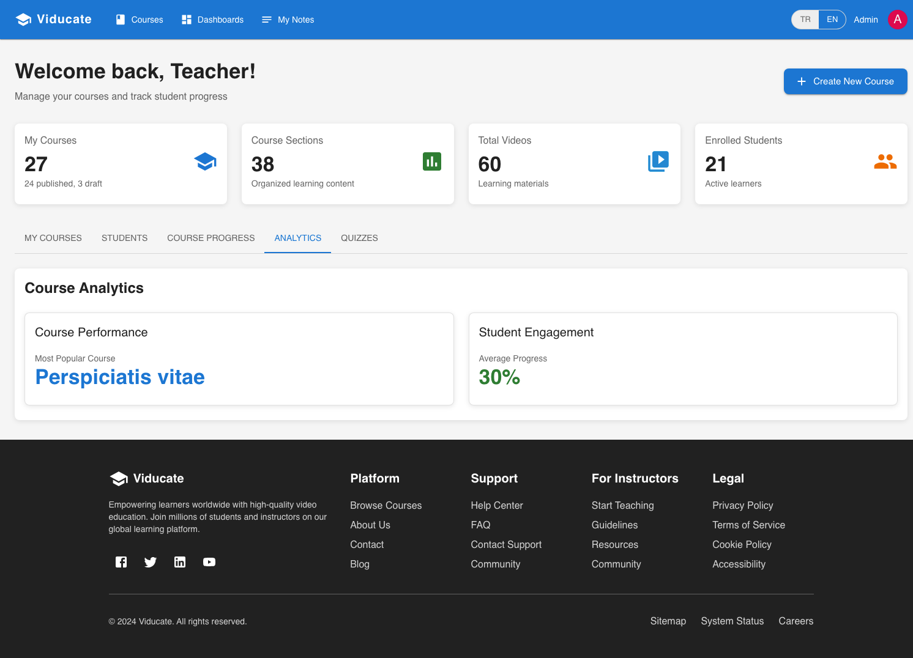 |

### 🛡️ Admin & Control
| | |
|---|---|
| 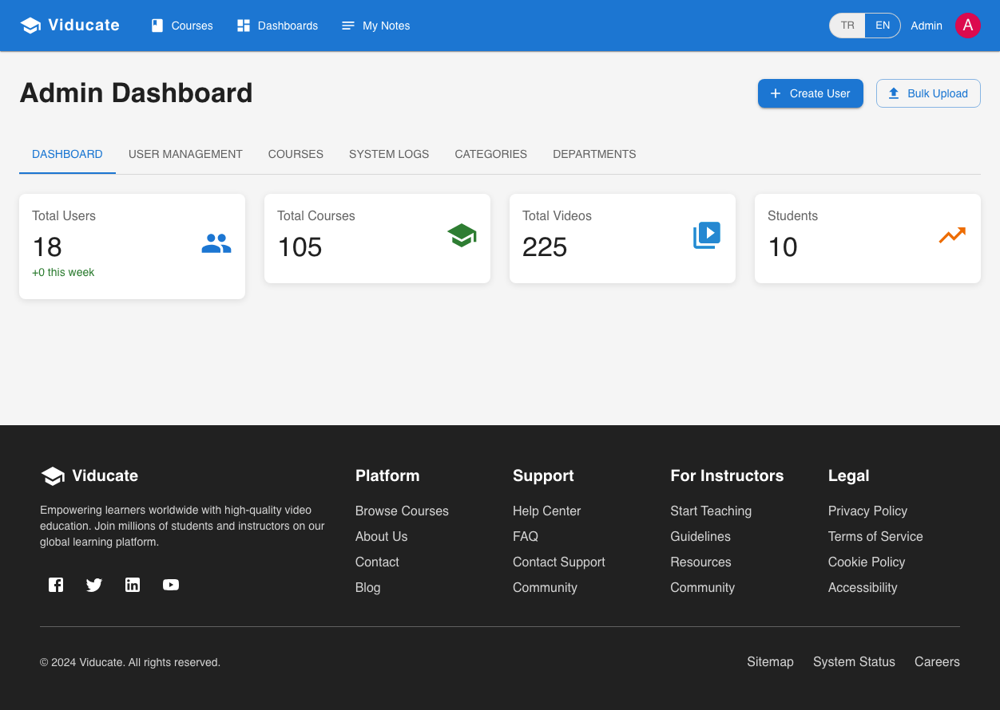 | 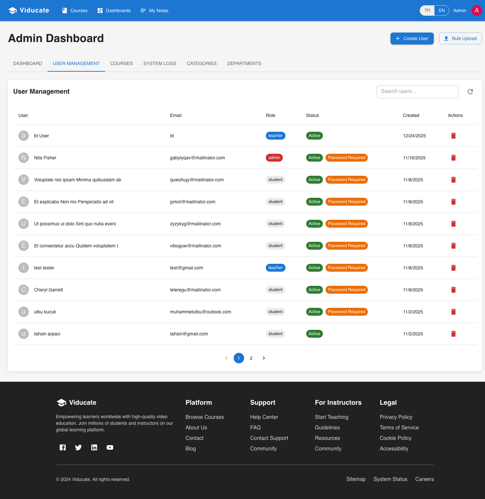 |
| 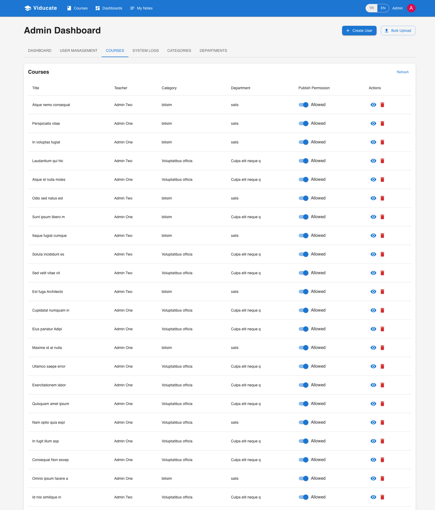 | 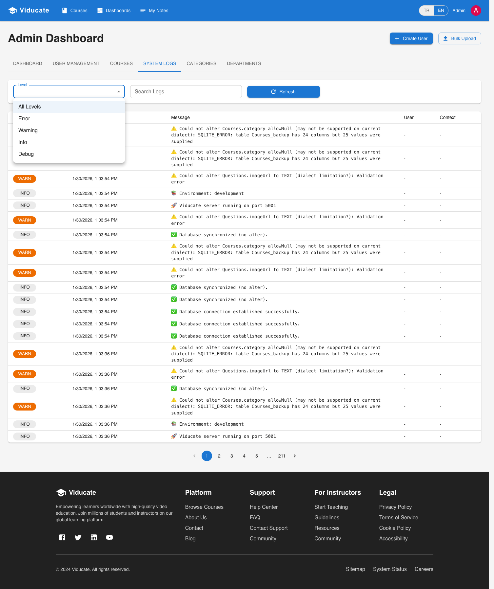 |

---
## 🚀 Technical Stack

### Frontend
- **Framework**: [React.js](https://reactjs.org/) (Hooks, Context API)
- **UI Architecture**: Material UI (MUI) components with custom theme.
- **Analytics**: Recharts for visualizing student progress and engagement.
- **Playback**: Video.js and React Player integration for multi-source support.
- **i18n**: Fully localized using `react-i18next`.

### Backend
- **Engine**: Node.js & Express.js.
- **Database**: PostgreSQL (Production) / SQLite (Dev) managed via **Sequelize ORM**.
- **Auth**: Hybrid JWT + LDAP (Active Directory) authentication layer.
- **Processing**: FFmpeg integration for generating video metadata and processing files.
- **Email**: Integration with Resend and traditional SMTP.

---

## 🛠️ Detailed Setup Guide

### 1. Prerequisites
Before installing, ensure you have the following installed on your system:
- **Node.js**: v18.0 or higher.
- **Git**: For version control.
- **FFmpeg**: Essential for generating video thumbnails and calculating durations.
  - *Ubuntu*: `sudo apt install ffmpeg`
  - *MacOS*: `brew install ffmpeg`
- **PostgreSQL**: (Optional) For production-grade database usage.

### 2. Installation
The project uses a monorepo-friendly structure. You can install all dependencies from the root:

```bash
git clone <repository-url>
cd viducate
npm run install-all
```

### 3. Environment Configuration

#### Backend (`backend/.env`)
Copy the template and fill in your values:
```bash
cp backend/env.example backend/.env
```
Key variables to update:
- `JWT_SECRET`: Generate a strong random string.
- `DATABASE_URL`: Your PostgreSQL connection string (defaults to local SQLite if empty).
- `LDAP_*`: Config if you want corporate AD login enabled.

#### Frontend (`frontend/.env`)
```bash
cp frontend/env.example frontend/.env
```

### 4. Running the Development Server
```bash
# Start both Frontend and Backend concurrently
npm run dev
```
- **Web App**: `http://localhost:3000`
- **API Server**: `http://localhost:5001` (Proxied in development)

---

## 🛡️ Corporate Features: LDAP/AD Integration

Viducate includes a highly flexible **Hybrid Authentication Engine**:
- **Smart Discovery**: Local DB is checked first; if not found, it attempts corporate LDAP bind.
- **JIT Provisioning**: New corporate users are automatically created in the local database upon their first successful LDAP login (Just-In-Time).
- **Secure Bind**: Supports both Service Account bind and Direct User bind configurations.

---

## 📊 Video Analytics & Tracking Logic

Viducate uses a sophisticated logic to ensure learning integrity:
- **Range Support**: Custom Express middleware to handle `Accept-Ranges: bytes`, ensuring 10GB+ videos stream perfectly.
- **Progress Algorithm**: Videos are marked "Complete" only when the student watches >80% of the content.
- **Snapshot Logic**: The player saves the current timestamp every 30 seconds, allowing students to resume exactly where they left off.

---

## 🚢 Production Deployment

For Linux servers (Ubuntu/Debian), we recommend the included automation scripts:

1. **Deployment Script**: `deployment/setup.sh`
   - Automatically installs system dependencies (Nginx, PM2).
   - Configures the Nginx reverse proxy.
   - Sets up PM2 for process monitoring.
2. **Nginx Optimization**: The project includes templates to handle large video uploads (up to 10GB) by increasing `client_max_body_size`.

---

## 📂 Project Directory Structure

```text
viducate/
├── backend/            # Express API Server
│   ├── src/
│   │   ├── controllers/# Business logic (Auth, Courses, Quizzes)
│   │   ├── models/     # Database Schemas (Sequelize)
│   │   ├── routes/     # REST Endpoints
│   │   └── services/   # Outsourced logic (Email, LDAP)
│   └── uploads/        # Local storage (Videos, PDFs, Profiles)
├── frontend/           # React SPA
│   ├── src/
│   │   ├── components/ # Atomic UI components
│   │   ├── pages/      # View layouts
│   │   └── contexts/   # Global State (Auth)
└── deployment/         # PM2 Configs & Nginx Templates
```

---

## ❓ Troubleshooting

- **Video Freezing?**: Ensure `FFmpeg` is installed and accessible in your system PATH.
- **CORS Errors?**: Check the `FRONTEND_URL` in your backend `.env` matches your browser URL.
- **Database Errors?**: If using SQLite, ensure the user has write permissions to the `backend/` directory to create the `.db` file.

---

## 📄 License

This project is licensed under the MIT License - see the LICENSE file for details.
